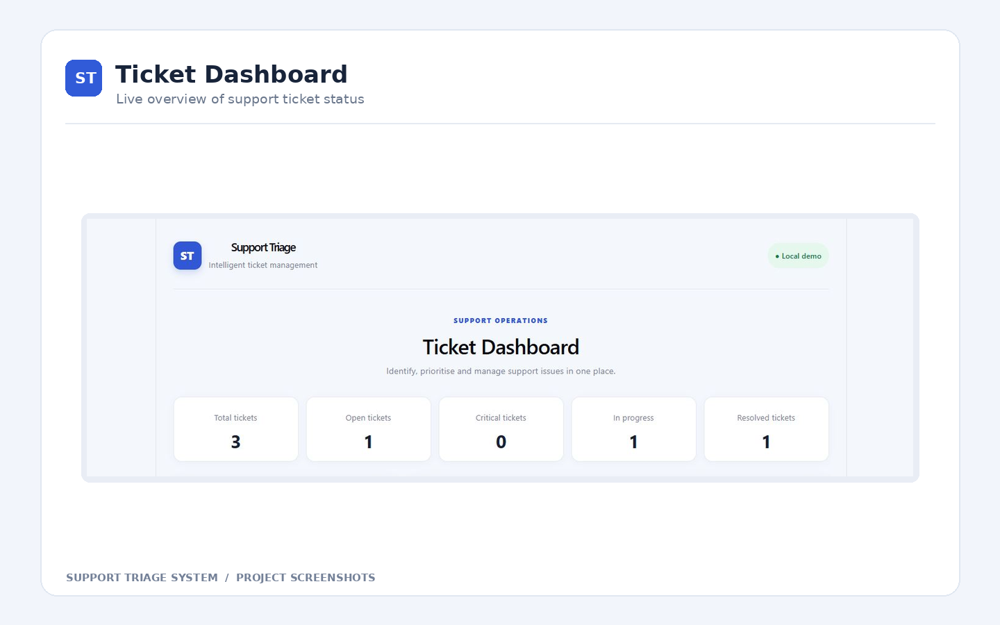
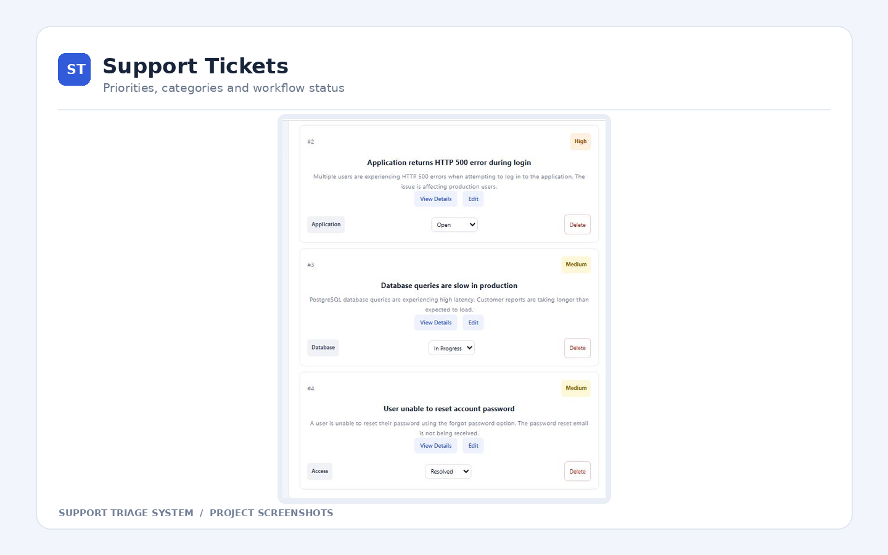
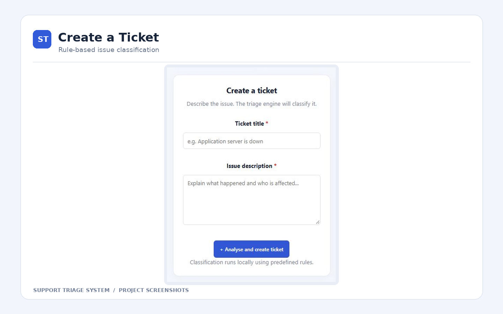
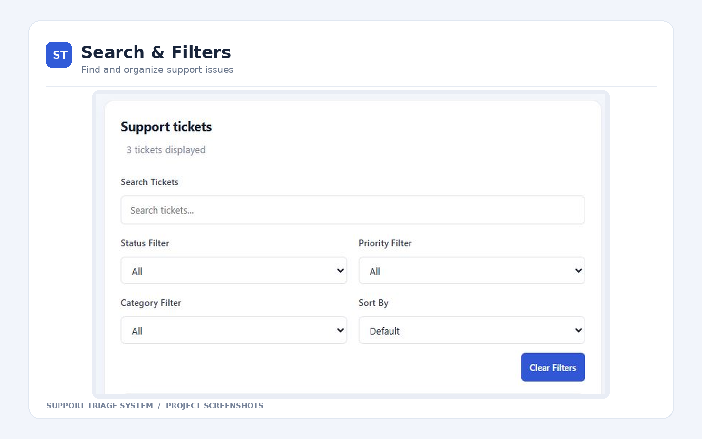
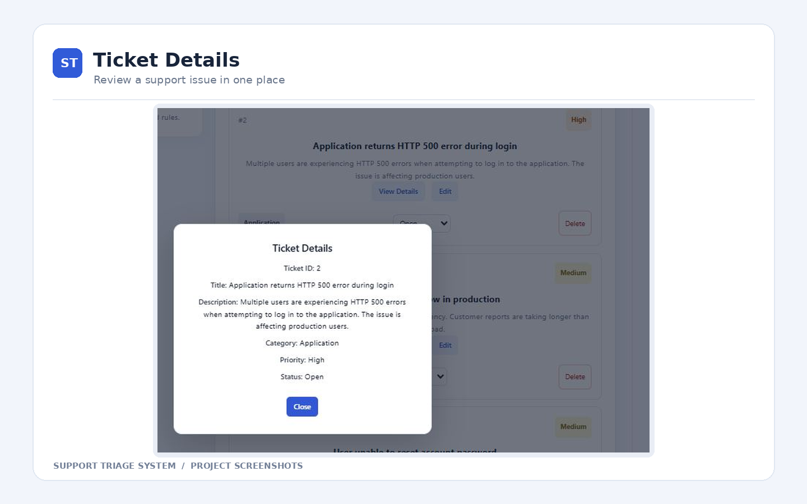
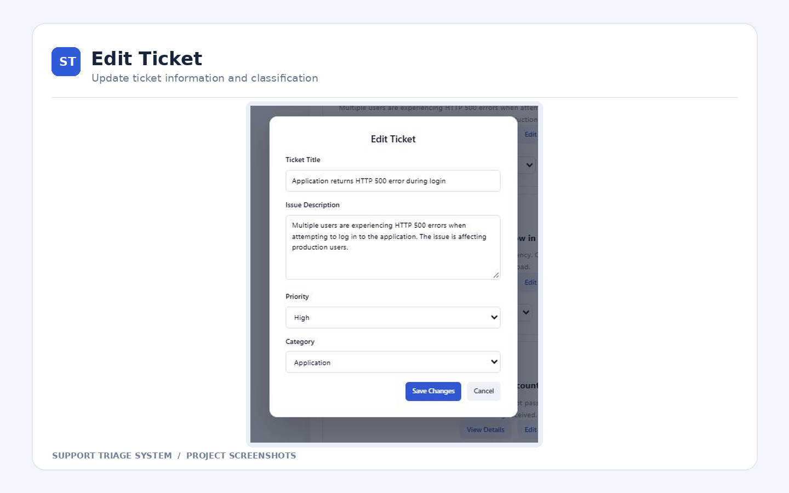

# Support Triage System

A full-stack Support Ticket Management System built using **React, Java Spring Boot, and PostgreSQL**.

This application helps users create, manage, investigate, and track support tickets through a web-based dashboard.

## 1. Technology Stack

| Layer | Technology |
|---|---|
| Frontend | React, JavaScript, CSS, Vite |
| Backend | Java 21, Spring Boot, REST APIs |
| Database | PostgreSQL |
| Database Integration | Spring Data JPA |
| Build Tools | npm, Gradle |
| Version Control | Git, GitHub |
| Development Tools | VS Code, Postman, PowerShell |

## 2. Features

- Create support tickets
- View complete ticket details
- Edit existing tickets
- Delete tickets with confirmation
- Update ticket status
- Search tickets
- Filter by status, priority, and category
- Sort tickets by priority
- Dashboard statistics
- Rule-based ticket classification
- PostgreSQL database persistence
- Responsive user interface

**Note:** Ticket classification currently uses predefined rules, not an external AI service.

## 3. Application Architecture

```text
React Frontend (Port 5173)
           |
           | HTTP REST API
           |
Spring Boot Backend (Port 8080)
           |
           | Spring Data JPA
           |
PostgreSQL Database
    (support_triage_db)
```

## 4. Project Structure

```text
support-triage-system/
│
├── support-triage/
│   ├── src/
│   ├── public/
│   ├── package.json
│   └── vite.config.js
│
├── support-triage-backend/
│   ├── src/
│   ├── gradle/
│   ├── build.gradle
│   ├── gradlew
│   └── gradlew.bat
│
├── .gitignore
└── README.md
```

## 5. Prerequisites

Install the following:

- Java 21
- Node.js and npm
- PostgreSQL
- Git

Check installed versions using PowerShell:

```powershell
java -version
node -v
npm.cmd -v
git --version
```

## 6. PostgreSQL Setup

Create a PostgreSQL database named:

```sql
CREATE DATABASE support_triage_db;
```

Database configuration is located in:

`support-triage-backend/src/main/resources/application.properties`

```properties
spring.application.name=support-triage-backend
spring.datasource.url=jdbc:postgresql://localhost:5432/support_triage_db
spring.datasource.username=postgres
spring.datasource.password=${DB_PASSWORD}
spring.datasource.driver-class-name=org.postgresql.Driver

spring.jpa.hibernate.ddl-auto=update
spring.jpa.show-sql=true
```

The database password is supplied through an environment variable and is not stored in the source code.

## 7. Backend Commands — Spring Boot

### Navigate to the backend

```powershell
cd E:\Project\support-triage-backend
```

### Set PostgreSQL password

```powershell
$env:DB_PASSWORD = Read-Host "Enter PostgreSQL password"
```

### Start the Spring Boot backend

```powershell
.\gradlew.bat bootRun
```

### Start the backend using one command

```powershell
cd E:\Project\support-triage-backend; $env:DB_PASSWORD = Read-Host "Enter PostgreSQL password"; .\gradlew.bat bootRun
```

Backend URL:

`http://localhost:8080`

### Build the backend

```powershell
.\gradlew.bat build
```

### Run automated tests

```powershell
.\gradlew.bat test
```

### Clean and rebuild

```powershell
.\gradlew.bat clean build
```

### Stop the backend

Press `Ctrl + C` in the terminal running Spring Boot.

## 8. Frontend Commands — React

### Navigate to the frontend

```powershell
cd E:\Project\support-triage
```

### Install dependencies

```powershell
npm.cmd install
```

### Start the React development server

```powershell
npm.cmd run dev
```

Frontend URL:

`http://localhost:5173`

### Build the frontend

```powershell
npm.cmd run build
```

### Preview the production build

```powershell
npm.cmd run preview
```

### Run lint checks

```powershell
npm.cmd run lint
```

The lint command requires a `lint` script in `package.json`.

### Stop the frontend

Press `Ctrl + C` in the terminal running Vite.

**Windows PowerShell note:** Use `npm.cmd` if PowerShell blocks `npm.ps1` because of execution policy restrictions.

## 9. API Endpoints

The application uses REST APIs to communicate between React and Spring Boot.

| Method | Endpoint | Description |
|---|---|---|
| GET | `/api/tickets` | Retrieve tickets |
| POST | `/api/tickets` | Create a ticket |
| PUT | `/api/tickets/{id}` | Update a ticket |
| DELETE | `/api/tickets/{id}` | Delete a ticket |

The frontend also supports changing ticket status through the backend.

## 10. Git Commands

### Navigate to the Git repository

```powershell
cd E:\Project
```

### Check Git status

```powershell
git status
```

### Check connected GitHub repository

```powershell
git remote -v
```

### View changes

```powershell
git diff
```

### Stage all changes

```powershell
git add .
```

### Review staged changes

```powershell
git diff --cached --stat
git diff --cached --check
```

### Commit changes

```powershell
git commit -m "Update Support Triage System"
```

### Push changes to GitHub

```powershell
git push origin main
```

### Pull the latest changes from GitHub

```powershell
git pull origin main
```

### View commit history

```powershell
git log --oneline
```

### Check the current branch

```powershell
git branch
```

### Clone the repository onto another computer

```powershell
git clone https://github.com/fathimat/support-triage-system.git
```

### Initial Git setup — for a new repository only

```powershell
git init
git branch -M main
git remote add origin https://github.com/fathimat/support-triage-system.git
```

These initial setup commands are **not needed again** for this existing repository.

## 11. Everyday Development Workflow

Start PostgreSQL, then open two PowerShell terminals.

**Terminal 1 — Backend**

```powershell
cd E:\Project\support-triage-backend
$env:DB_PASSWORD = Read-Host "Enter PostgreSQL password"
.\gradlew.bat bootRun
```

**Terminal 2 — Frontend**

```powershell
cd E:\Project\support-triage
npm.cmd run dev
```

Open `http://localhost:5173` in your browser.

After making code changes:

```powershell
cd E:\Project
git status
git add .
git commit -m "Describe your changes"
git push origin main
```

## 12. Application Screenshots

Screenshots of the working application will be added here.

### Dashboard

Screenshot coming soon.

### Create Ticket

Screenshot coming soon.

### View Ticket Details

Screenshot coming soon.

### Edit Ticket

Screenshot coming soon.

## 13. Future Improvements

- AI-powered ticket classification
- Authentication and role-based access
- Automatic ticket assignment
- Advanced reporting and analytics
- Cloud deployment

## 14. GitHub Repository

https://github.com/fathimat/support-triage-system

## Author
 
Developed as a full-stack Java and React portfolio project demonstrating REST API development, database integration, troubleshooting workflows, and support ticket management.


## Live Demo

**Application:** https://support-triage-frontend.onrender.com

**Backend API:** https://support-triage-system.onrender.com/api/tickets

### Project Overview

Support Triage System is a full-stack ticket management
application built using React, Java Spring Boot, and
PostgreSQL.

The application allows users to create, view, edit,
search, filter, and delete support tickets.

It uses rule-based classification to categorize tickets
and assign priorities based on issue descriptions.

### Technology Stack

- Frontend: React, Vite
- Backend: Java 21, Spring Boot, REST APIs
- Database: PostgreSQL (Neon)
- Deployment: Render
- Version Control: GitHub

### Verified Features

- Create, view, update, and delete tickets
- Ticket status management
- Rule-based category and priority classification
- Dashboard statistics
- PostgreSQL data persistence
- Cloud-hosted frontend and backend

**Note:** The free backend may take some time to
respond after inactivity.


## Application Screenshots

The following screenshots demonstrate the main features of the
Support Triage System, including ticket management, classification,
dashboard statistics, and search functionality.

### 1. Ticket Dashboard

Overview of ticket statistics, including total tickets,
open tickets, critical tickets, in-progress tickets,
and resolved tickets.



### 2. Support Ticket List

View support tickets with their assigned priorities,
categories, statuses, and available actions.



### 3. Create a Support Ticket

Create a new support ticket by entering a title and
issue description. The application uses predefined
rules to classify the ticket.



### 4. Search and Filter Tickets

Search tickets and filter them by status, priority,
or category. Sort tickets using the available options.



### 5. View Ticket Details

View complete ticket information, including title,
description, category, priority, and current status.



### 6. Edit a Support Ticket

Update ticket information, priority, and category
using the Edit Ticket form.


